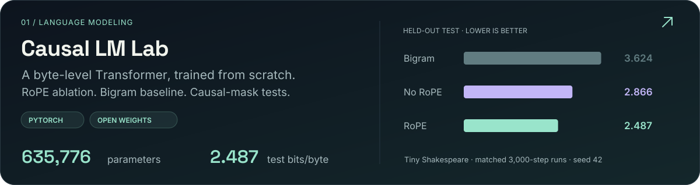
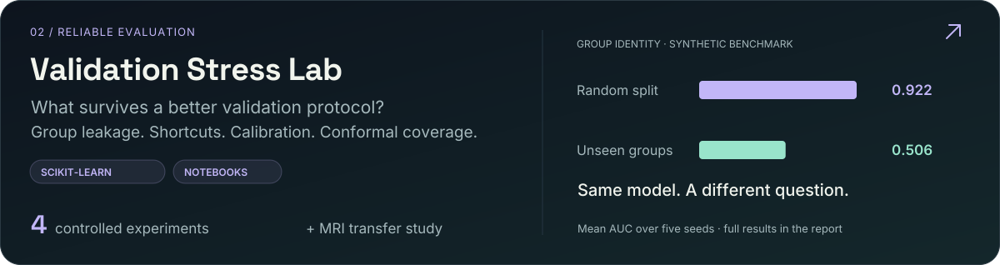
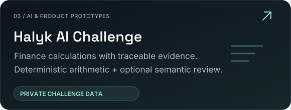
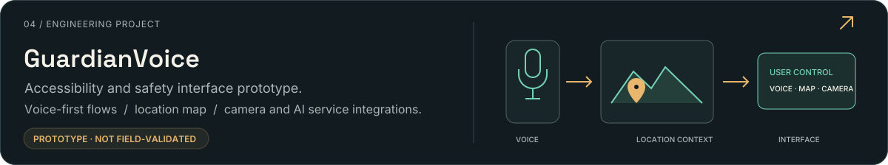

  <picture>
    <source media="(max-width: 600px)" srcset="assets/header-mobile.svg" />
    
  </picture>

  <b>I learn ML by implementing the mechanics, running controlled experiments, and turning ideas into working prototypes.</b>

  
  
  
  

## Selected experiments

<a href="https://github.com/zoga228/causal-lm-lab"><picture><source media="(max-width: 600px)" srcset="assets/causal-lm-mobile.svg" /></picture></a>

**[Explore the implementation →](https://github.com/zoga228/causal-lm-lab)** &nbsp; · &nbsp; [Download the weights](https://huggingface.co/Zangeeeeerange/causal-byte-lm-shakespeare) &nbsp; · &nbsp; [Inspect the learning curves](https://github.com/zoga228/causal-lm-lab/blob/main/reports/learning-curves.png)

<a href="https://github.com/zoga228/validation-stress-lab"><picture><source media="(max-width: 600px)" srcset="assets/validation-mobile.svg" /></picture></a>

**[Read the experiments →](https://github.com/zoga228/validation-stress-lab)** &nbsp; · &nbsp; [Executed notebooks](https://github.com/zoga228/validation-stress-lab/tree/main/notebooks) &nbsp; · &nbsp; [MRI transfer study](https://github.com/zoga228/validation-stress-lab/tree/main/competition/rsna)

## AI & product prototypes

  
  

[**Samuraidoku →**](https://github.com/zoga228/samuraidoku) Puzzle generation, interactive learning and multiplayer in a Sudoku product prototype.

## Tools & foundations

<picture><source media="(max-width: 600px)" srcset="assets/toolkit-mobile.svg" /></picture>

[**ML Foundations →**](https://github.com/zoga228/ml-foundations) Earlier regression, clustering and vision exercises, collected with links to their original history.

<b>What you can verify in these projects</b>

- **Code and protocol:** data provenance, splits, baselines and reproduction commands.
- **Measured results:** held-out evaluation for the language model; explicitly labelled synthetic counterexamples in the validation lab.
- **Limitations:** one-seed language-model results, negative findings, small-sample MRI uncertainty and prototype boundaries stay in the reports.
- **Development:** AI assistance and third-party references are documented within the projects.

 

