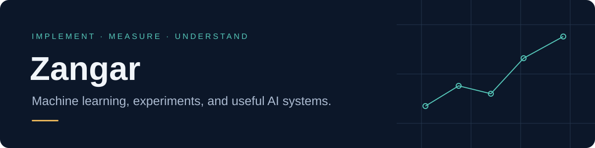

I explore machine learning by building models, testing their assumptions, and turning ideas into working prototypes. My current focus is causal language modeling and reliable evaluation.

[Kaggle](https://www.kaggle.com/zangar09417) · [Hugging Face](https://huggingface.co/Zangeeeeerange)

### Selected work

| Project | What to inspect |
|---|---|
| **[Causal LM Lab](https://github.com/zoga228/causal-lm-lab)** | A byte-level transformer trained from scratch. RoPE ablation, bigram baseline, causal-mask tests, learning curves and held-out results. |
| **[Validation Stress Lab](https://github.com/zoga228/validation-stress-lab)** | Reproducible experiments about group leakage, shortcut learning, probability calibration and conformal coverage under shift. |
| **[Halyk AI Challenge](https://github.com/zoga228/halyk_ai_challenge)** | Deterministic financial arithmetic with traceable evidence and an optional budget-limited semantic review. Private challenge data is required for full reproduction. |
| **[GuardianVoice](https://github.com/zoga228/infomatrix_2026_GuardianVoice)** | An accessibility and safety interface prototype with voice activation, maps and AI service integration. Prototype limitations are documented. |
| **[Samuraidoku](https://github.com/zoga228/samuraidoku)** | A Sudoku product prototype combining puzzle generation, interactive learning and multiplayer features. |

### Foundations

[ML Foundations](https://github.com/zoga228/ml-foundations) collects earlier regression, clustering and vision exercises. Archived repositories preserve the original learning history.

### How I evaluate work

Every research-style repository links its code, evaluation protocol and measured results. Baselines and negative findings stay in the report. Synthetic demonstrations are labelled, and a training score is never presented as held-out performance. Development assistance is documented within the projects.
